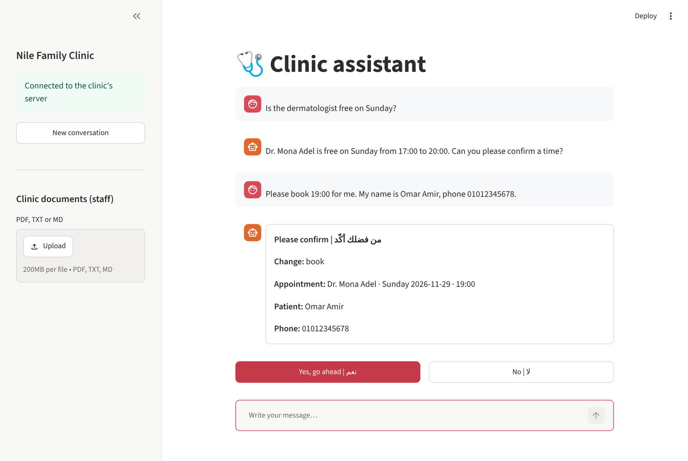
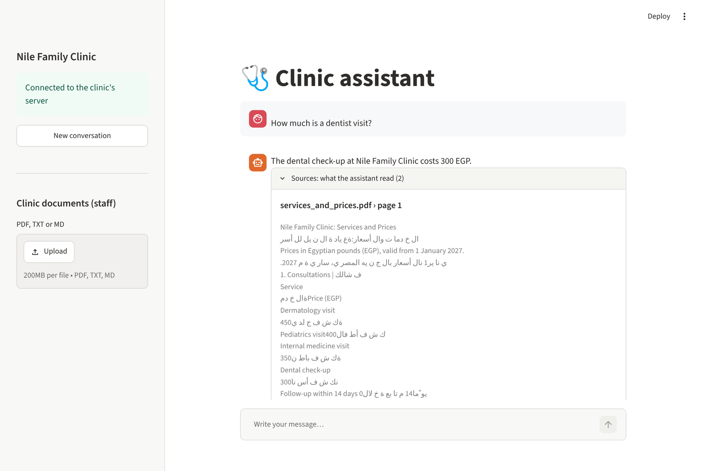
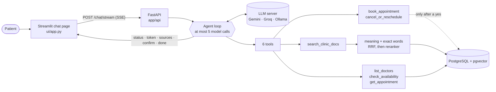

<p align="center">
  
</p>

<p align="center">
  
  
  
  
  
  
</p>

<p align="center">
  <b>Lab code for AI Engineering with Python, Program 1</b><br>
  Training Unit · Higher Institute for Computer Science and Information Systems
</p>

<p align="center">
  <a href="#-see-it">See it</a> ·
  <a href="#-the-stack">The stack</a> ·
  <a href="#-how-one-message-travels">How one message travels</a> ·
  <a href="#-one-branch-per-session">Sessions</a> ·
  <a href="#-run-it">Run it</a>
</p>

> [!NOTE]
> Nile Family Clinic is fictional. This is an educational prototype, not a medical system.

---

## 👀 See it

A patient asks in Arabic or English. The assistant answers from the clinic's own documents and shows what it read; to book, it shows a confirmation card and waits for a yes.

<table>
  <tr>
    <td width="50%"></td>
    <td width="50%"></td>
  </tr>
  <tr>
    <td align="center"><b>Book after a yes</b><br><sub>The card's rows come from the database, not from the model.</sub></td>
    <td align="center"><b>Answer with sources</b><br><sub>"Sources" opens the chunks the answer was built from.</sub></td>
  </tr>
</table>

---

## 🧰 The stack

| | Layer | What we use | What it does here | Since |
| :---: | --- | --- | --- | :---: |
| 🐍 | Language and tooling | Python 3.13 · [uv](https://docs.astral.sh/uv/) | One command installs and runs everything | 1 |
| 🧠 | Language model | Any OpenAI-compatible server through the `openai` SDK: Gemini `gemini-2.5-flash`, Groq `openai/gpt-oss-20b`, Ollama `qwen2.5:3b` | Switching provider is three lines in `.env` | 1 |
| ⚙️ | Settings | pydantic-settings | Every setting typed and checked at startup | 2 |
| 🚪 | API | FastAPI · Pydantic v2 | Contracts, validation at the door, one error shape | 3 |
| 📄 | Documents | PyMuPDF | PDF, TXT and MD in, checked, cleaned and cut into chunks | 4 |
| 🗄️ | Database | PostgreSQL 17 + pgvector · SQLAlchemy 2 (async, asyncpg) | Doctors, slots, bookings, documents, chunks and chats in one place | 5 |
| 🐳 | Containers | Docker Compose | The database and the API, the same on every laptop | 5 |
| 🔒 | Safe booking | Row locks · idempotency keys · one transaction per change | Never double-books, even when two patients click at once | 6 |
| 🔎 | Search | `intfloat/multilingual-e5-small` + PostgreSQL full-text search, fused with RRF, reranked by `BAAI/bge-reranker-v2-m3` | Finds the right chunk by meaning and by exact words, and can say "nothing found" | 7 |
| 📚 | Grounded answers | Prompts in files · structured outputs · citation checks | Every claim points at a real source, or the answer is "I don't know" | 8 |
| 🤖 | Agent | Our own loop · 6 tools · a yes before every change | Reads freely; books, cancels and reschedules only after the patient confirms | 9 |
| ⚡ | Streaming and UI | Server-Sent Events · Streamlit | Status at once, then the words as the model writes them | 10 |

---

## 🗺️ How one message travels



---

## 🌿 One branch per session

Each session continues from the one before it. `main` always holds the latest session.

| | Branch | Session |
| :---: | --- | --- |
| 🩺 | [`session-1`](../../tree/session-1) | Problem-First & Why Naive AI Fails |
| 📐 | [`session-2`](../../tree/session-2) | Lightweight Design & Clean Architecture |
| 🚪 | [`session-3`](../../tree/session-3) | API Contracts & Validation |
| 📄 | [`session-4`](../../tree/session-4) | Secure Document Ingestion & Chunking |
| 🗄️ | [`session-5`](../../tree/session-5) | Data Modeling & Containers |
| 🔒 | [`session-6`](../../tree/session-6) | Reliable Pipelines & Safe Booking · **Checkpoint 1** |
| 🔎 | [`session-7`](../../tree/session-7) | Hybrid Search & Reranking |
| 📚 | [`session-8`](../../tree/session-8) | Grounded Answers & Structured Outputs |
| 🤖 | [`session-9`](../../tree/session-9) | Building the Clinic Agent |
| ⚡ | [`session-10`](../../tree/session-10) | Streaming UI & Build-It Capstone · **Capstone 1** |

```bash
git clone https://github.com/OmarAmir2001/clinic-assistant.git
cd clinic-assistant
git switch session-10
```

---

## ▶️ Run it

You need Python 3.13, [uv](https://docs.astral.sh/uv/) and Docker. Copy `.env.example` to `.env` and paste your own key.

```bash
docker compose up -d db                       # PostgreSQL + pgvector
uv run python -m app.db.setup                 # tables, doctors and slots
uv run fastapi dev                            # terminal 1: the API, http://localhost:8000/docs
uv run python -m streamlit run ui/app.py      # terminal 2: the chat page, http://localhost:8501
```

And from the terminal:

```bash
uv run python -m labs.stream "Which dermatologist is free on Sunday?"   # every event, with the second it came
uv run python -m labs.trace                                            # the newest conversation, step by step
uv run python -m labs.booking_flow                                     # Session 9's 7 checks, still passing
```

> [!IMPORTANT]
> Never commit `.env`: it holds your API key and your database password.

---

## 🎓 This branch: Session 10, Streaming UI & Build-It Capstone

`POST /chat/stream` is the same agent as `POST /chat`, but as Server-Sent Events: the patient sees what it is doing
("Looking up free times…"), then the answer as the model writes it. `ui/app.py` is a chat page in Streamlit: step
progress, the sources it read, a confirmation card with Yes / No buttons, document upload for staff, and clear
messages when the server or the model is down. `labs/trace.py` reads a conversation back from the database, tool call
by tool call: that is how we find where an answer went wrong.

No database change since Session 9.

🏁 Capstone 1 (what each pair presents, and how it is marked) is in [`docs/capstone-1.md`](docs/capstone-1.md).

